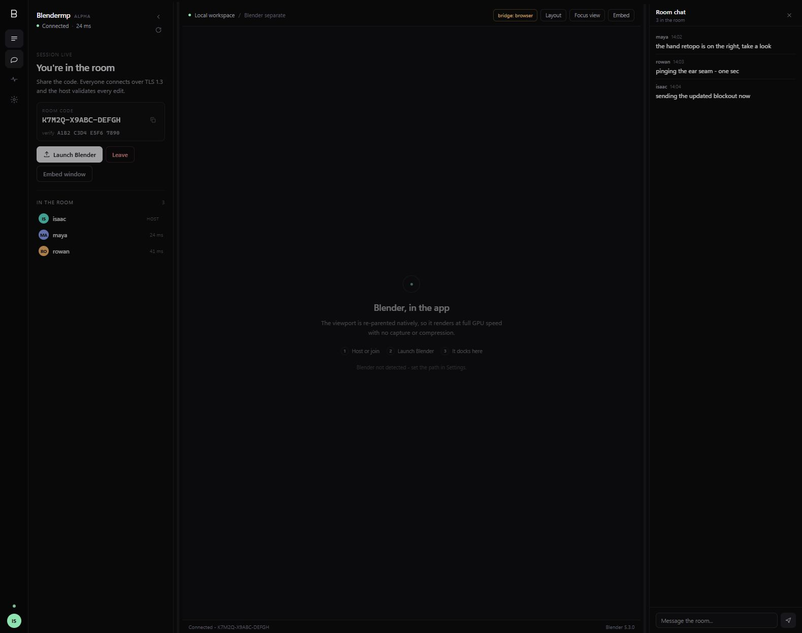

# Blendermp

Low-latency collaborative Blender sessions, with a desktop app that launches
Blender and **docks the live window over the app viewport** (a native owned
window, not video capture, so it keeps full GPU performance and avoids the black
surface that cross-process re-parenting causes on some GPUs).

> **Status: alpha vertical slice.** Hosting, the public server browser, TLS
> pinning, presence, chat, object transforms, mesh streaming, live Edit Mode
> vertex edits and window docking work.
> Cross-network sessions use the self-hosted relay or the Cloudflare Worker hub.
> Edit-mode topology (extrude/subdivide), full node graphs, animation and
> simulations are not implemented yet.



## What works today

* **Public server browser.** Hosts set a server name, publish it to a directory,
  and optionally add a password. Everyone can search by name and click to join;
  room codes stay internal. Hosts can kick players from the member list. The
  directory is a small self-hosted JSON service; entries expire after 60 seconds.
* **Cross-network without port forwarding.** A free Cloudflare Worker
  (`cloudflare/`) provides the public directory **and** the WebSocket relay. The
  host ticks Public and clients anywhere find it in the browser. TLS stays
  end-to-end; the Worker only forwards ciphertext. A self-hosted Python
  relay/directory (`docs/RELAY.md`) is the fallback.
* **Scene bootstrap on join**: the host streams its existing objects, meshes,
  materials, modifiers, collections, active camera, world background and render
  settings; the joining Blender replaces its local scene with that snapshot
  before live sync starts, so both start identical.
* **Live Edit Mode vertex sync**: vertex moves stream as compact deltas at up to
  30 Hz in both directions, without leaving Edit Mode. Structural edits apply
  when the editor leaves Edit Mode.
* **One editor per object**: selecting an object claims an edit lease. Other
  players see it locked (unselectable) and cannot edit it until the owner
  deselects or leaves. The active object name is shown for each player.
* **Remote presence in the viewport**: each player's viewport camera is drawn as
  a colored view pyramid with a look-direction ray and their name above it, and
  their selected objects are wireframed in their color with a name tag. Camera
  poses stream at up to 30 Hz on low-latency links, apply immediately, and are
  normalized so orthographic zoom cannot distort the widget. Name
  tags use a DPI-scaled
  outlined font so they stay crisp. Each user gets a stable color derived from
  their name if they have not chosen one.
* **Presence 2.0**: remote Edit Mode vertex selections as colored points, a
  remote 3D cursor crosshair, follow a user's viewport, and per-overlay
  visibility toggles.
* **Server-enforced roles**: the host assigns viewer, commenter, editor or admin
  from the member list. Mutating frames and lease acquisition are rejected for
  viewers/commenters; downgrading releases their leases.
* **Authenticated relay hosting**: each installation has a random host key; the
  Worker stores only its hash and requires it for the host WebSocket. A public
  room cannot be taken over by another host, and the key is never listed.
* **TLS 1.3 everywhere**, self-signed host certificate, SHA-256 fingerprint
  pinning and a short verification code (no custom crypto).
* **Host-authoritative protocol**: validated message types, size/rate limits,
  finite transform checks, mesh bounds, lease ownership, host-assigned names.
* **Chunked mesh deltas** for dense meshes: per-chunk XOR hashing, changed-vertex
  deltas, int16 quantisation, `foreach_set` application with no geometry rebuild.
  Structural edits fall back to a full geometry snapshot (vertices, edges, loops,
  polygons, UVs, smooth flags, material indices).
* **Object creation and deletion**: new mesh/empty/camera/light/curve/text objects
  are sent with a full geometry snapshot (mesh) and appear on the other side,
  respecting the source collection name when it exists; deleting sends a UUID
  tombstone. Transforms stream at up to 60 Hz on low-latency/LAN links (30 Hz
  otherwise) and multiple tracked meshes round-robin at 20 Hz. A LAN-discovered
  host advertises a direct code that bypasses the relay.
* **Immediate remote application**: received transforms and vertex deltas are
  applied exactly at network rate (up to 60 Hz on LAN). There is no display
  interpolation, so the remote view never lags behind the authoritative state.
* **Basic material sync**: Principled BSDF base colour, metallic, roughness and
  emission, plus the viewport colour, for the active object. Node graphs and
  textures are not replicated yet.
* **Modifier stack sync**: common modifiers (Subdivision, Mirror, Array, Solidify,
  Bevel, Decimate, Triangulate, Smooth, Weld, Screw) and geometry-nodes group
  references, with visibility flags, for the active object.
* **Image sharing**: send the images used by the active object materials as packed
  PNG/JPEG/EXR/etc. assets; receivers get a packed image datablock.
* **Edit leases with request/grant**: request edit on the active object, the owner
  gets a notification and can grant it from the panel or with `/grant <user>`.
* **Presence, chat and 3D pings** between the addon UI and the desktop app, with
  latency and bandwidth telemetry, pause-sync, follow-host frame, and chat
  commands (`/who`, `/ping`, `/leave`, `/me`).
* **Desktop shell** (Tauri 2, Rust + static HTML/CSS/JS): launches Blender,
  writes the control request, docks Blender into the stage, shows the server
  browser, participants, chat, diagnostics and a live verification code.
* **Modular tile workspace with fixed docks**: click **Layout** to enter edit
  mode, then drag Session, Chat or Diagnostics by its top bar onto the **Left**,
  **Right** or **Bottom** dock. Panels reflow live as you hover a dock, swap
  cleanly when a dock is occupied, and settle with smooth transition when you
  release. The **viewport always stays in the main area**. Splitters resize each
  dock, the rail toggles panels, and every arrangement is saved. **Reset**
  restores the default layout (Session left, Chat right, empty bottom) with the
  same animated transition. Blender is hidden while arranging and returns to the
  viewport when you press Done or Escape.

The protocol and engine have **114 passing tests**, including a real TLS
host/client session, certificate-mismatch rejection, relay chat, password
rejection and host kick over a multiplexed tunnel, the public directory API, and
1,000-vertex delta round-trips under loss/reordering. The Cloudflare Worker hub
was also exercised locally with `wrangler dev`: announce/list, host and client
through the WebSocket relay, and kick.

## Cross-network

### Cloudflare Worker hub (recommended, no port forwarding)

Deploy the Worker once:

```powershell
cd cloudflare
npx wrangler login
npx wrangler deploy
```

Wrangler prints a URL like
`https://blendermp-hub.<your-subdomain>.workers.dev`. Put it in **Settings ->
Hub URL** on the host and every friend, with **Use the hub as the WebSocket
relay** checked. That is the only setup. The host ticks **Public**, the server
appears in everyone's browser, and connecting goes through the Worker relay.
See [cloudflare/README.md](cloudflare/README.md).

### Self-hosted Python relay and directory

```bash
# on a VPS or spare machine
python -m server.relay --host 0.0.0.0 --port 7100
python -m server.directory --host 0.0.0.0 --port 7101
```

Set **Hub URL** to `http://your-host:7101`, uncheck the Worker relay, and use
the advanced **Relay** field (`your-host:7100`) with **Host through the
advanced relay**. Published entries point at the relay; joining from the browser
is unchanged and the TLS certificate is still pinned to the host. See
[docs/RELAY.md](docs/RELAY.md).

## Quick start (Windows)

```powershell
# 1. Install toolchains + Blender + the vendored TLS dependency.
powershell -ExecutionPolicy Bypass -File scripts/bootstrap.ps1

# 2. Build and run the desktop app.
powershell -ExecutionPolicy Bypass -File scripts/dev.ps1
```

`dev.ps1` builds with the GNU Rust toolchain and starts the app. Set a server
name and password, then click **Host server**; the app launches Blender, the
addon starts hosting, and the window docks into the stage. With a **Hub URL**
configured and **List in the public server browser** enabled, the server appears
for everyone using that hub.

To start in a room immediately:

```powershell
scripts/dev.ps1 -Autohost
```

Joining: click **Browse servers**, search by name, and press **Join**. If the
server has a password, enter it in the prompt. The first connection pins the
host certificate and shows a verification code; compare it with the host's. The
host can kick anyone from the member list.

### Packaged build

```powershell
scripts/package.ps1
```

Produces:

* `dist/Blendermp-<version>-Setup.exe` - **Windows installer** (per-user, Start
  menu/desktop shortcuts, uninstaller, bundled addon). It checks for Blender;
  if none is found it offers to download the official Blender 5.3 MSI from
  blender.org, verifies the pinned SHA-256, installs it silently, and then
  installs Blendermp. Silent setup (`/S`) installs Blendermp only.
* `dist/blendermp-windows-x64-<version>.zip` — portable app + addon + docs.
* `dist/blender_multiplayer-<version>.zip` — Blender extension (validated),
  optional if you want to launch Blender outside the app.

Silent install: `Blendermp-0.1.0-Setup.exe /S`.

The installer places the addon next to the app, so **you do not need to install
the Blender extension** when using the desktop app. Install the extension only if
you want the addon available in a normal Blender window.

Extension install:

```powershell
scripts/install_extension.ps1
```

## Build details

The repo path contains a space, and `windres` (used by Tauri's resource step)
cannot handle that. The scripts build with a target directory outside the repo:

```powershell
$env:CARGO_TARGET_DIR = "$env:LOCALAPPDATA\Temp\bmp-target"
cargo build --manifest-path desktop/src-tauri/Cargo.toml
```

Tool prerequisites:

* Node.js LTS (installed by bootstrap; the UI has no build step)
* Rust + the `x86_64-pc-windows-gnu` toolchain
* MinGW-w64 / WinLibs (`gcc`, `windres`)
* Blender 5.x
* Python 3.11+ for tests, with `numpy`, `pytest`, `cryptography`

Blender's Python disables the user site, so the bootstrap installs
`cryptography` into `%LOCALAPPDATA%\Blendermp\python`, which the addon adds to
`sys.path` at load time. Without it the addon still loads and reports a clear
error instead of crashing.

## Layout

```
addon/blender_multiplayer/     Blender 5.x extension (importable package)
  core/  protocol, varint, room codes, chunker, TLS/certificate pinning
  net/   UDP transport + reliable link, LAN discovery, relay agents
  sync/  mesh mirror, object transforms, leases
  session.py  host/client state machine, validation, leases
  control.py  validated local control files shared with the app
  ui.py       N-panel
desktop/ui/                    static UI (no bundler)
desktop/src-tauri/             Tauri 2 shell + Win32 window docking
server/relay.py                self-hosted cross-network relay
server/directory.py            self-hosted public server directory
cloudflare/                    free Worker hub: public directory + WS relay

tests/                         protocol, chunker, leases, TLS, relay, live session
tools/                         icon generator, mesh round-trip, smoke client
scripts/                       bootstrap, dev launcher, packaging
```

## How the sync works

1. **Transforms**: the addon polls `matrix_world`, diffs against a shadow, and
   sends 16 float32 values over the transform channel. The host validates and
   relays; receivers apply to `matrix_world` and update their shadow so a remote
   move is never echoed back.
2. **Meshes**: positions are read with `foreach_get` into preallocated numpy
   buffers, split into 8,192-vertex chunks, hashed with a vectorised XOR reduce,
   and only changed chunks are diffed. Deltas carry varint index jumps and either
   float32 or int16-quantised coordinates. Receivers write the shadow buffer and
   `foreach_set` once, with no `clear_geometry`.
3. **Structural edits**: when counts change or a mesh is newly tracked, the addon
   sends a full geometry snapshot. Receivers rebuild vertices, edges, loops,
   polygons, UVs, smooth flags and material indices, then resume deltas.
4. **Presence/chat/pings** are JSON control frames; the host rewrites identities
   so names cannot be spoofed.
5. **Scene bootstrap**: when a client joins, the host sends `SCENE_RESET`, then
   each object (mesh geometry, materials, modifiers) over a few ticks, then
   `SCENE_READY`. The client clears its scene, applies the snapshot and seeds all
   shadows so nothing is echoed back.
6. **Live Edit Mode**: the editor's BMesh is sampled at up to 30 Hz and only
   changed vertices are sent. Receivers in Object Mode write them through
   `foreach_set`; receivers already in Edit Mode apply them through BMesh.
7. **Relay mode** wraps the same TLS connection in a multiplexed tunnel; the host
   keeps one outbound connection, so no public port is needed.
8. **The app and addon talk through validated JSON files** in
   `%LOCALAPPDATA%\Blendermp`, which keeps the integration dependency-free.

See `docs/PLAN.md` for the full architecture, performance targets and roadmap.

## Verified in this environment

* Blender 5.3 loads the addon headlessly and hosts on a real TLS listener.
* A headless client joins, exchanges presence and chat, and leaves cleanly.
* The same chat path works through the relay (`tests/test_relay.py`).
* A geometry snapshot round-trips through Blender's mesh API (vertices, edges,
  loops, UVs, smooth flags).
* The packaged extension validates and installs with
  `blender --command extension install-file`.
* The app launches Blender, docks its window, and reports the live server
  status, fingerprint and verification code.
* Two real Blender 5.3 instances: the host's scene, material, modifier,
  collection, camera, world and render settings bootstrap arrives on the client;
  object moves and live Edit Mode vertex drags propagate **both ways** without
  snapping back; the host's selection locks the object for the client until the
  host releases it.
* The production Worker relay was exercised with the host key: no token and a
  wrong token are rejected, a valid host tunnel and client join succeed.
* `pytest`: 106 passed.

## Limitations

* **No direct NAT hole punching.** Cross-network sessions use the Cloudflare
  Worker hub or the self-hosted relay. Direct LAN connections still bypass it.
* Multiple tracked meshes share the object-mode polling budget (20 Hz), so many
  large meshes update more slowly. The actively edited mesh has its own 30 Hz
  fast path.
* Two people cannot select/edit the same object at once: the first selector
  holds the lease. Deselecting or disconnecting releases it, including a short
  debounce so mode switches do not release accidentally.
* Remote camera widgets and selection wireframes are viewport overlays in the
  local Blender; they are not scene objects, are not rendered, and are not
  synced back to other clients. Camera poses update at up to 30 Hz and are
  applied immediately; their zoom scale is stripped so orthographic views cannot stretch
  them into stray lines. Selection outlines skip oversized/corrupt edges and
  fall back to a bounding box above 2,500 edges.
* Edit Mode streams vertex positions live. Structural changes (extrude,
  subdivide, delete) sync when the editor leaves Edit Mode, not during the drag.
* Worlds are limited to background colour/strength. Full shader node graphs,
  textures, armatures/animation, compositor nodes, simulations and linked
  libraries are not replicated yet.
* Modifier sync covers the common parameter set; unsupported modifier types only
  replicate type/name/visibility.
* New objects are replicated for meshes, empties, cameras and lights; curves,
  font objects and modifiers are not, and collections/parenting are only
  partially covered.
* Windows-only window docking; other platforms run Blender in its own window.
* Multires is not supported.
* Alpha software: back up work before a session.

## Troubleshooting

If Blender does not start or the session stays offline, check
`%LOCALAPPDATA%\Blendermp\blender.log` (Blender and addon output) and
`%LOCALAPPDATA%\Blendermp\ui.log` (desktop app). Blendermp requires Blender 5.x;
on a PC without it, the installer offers to install Blender 5.3 automatically.

## Security

Read [SECURITY.md](SECURITY.md). There is no custom cryptography: TLS 1.3 does
the transport, certificates are pinned, and the host validates every action.
